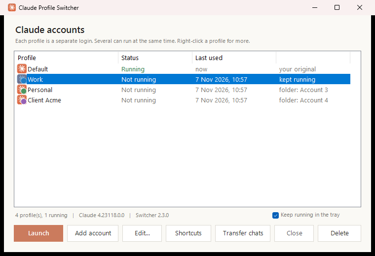
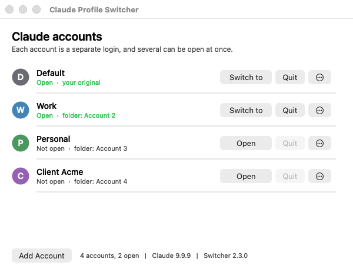
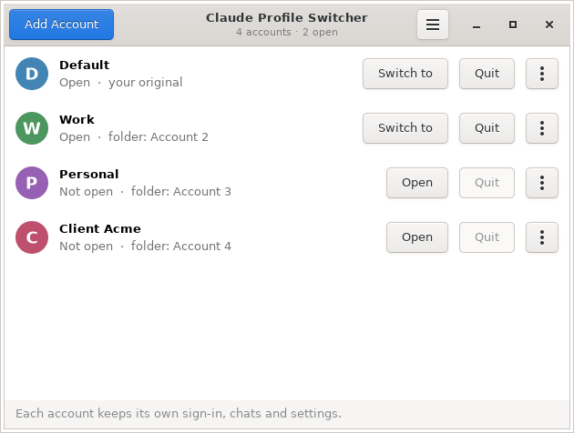
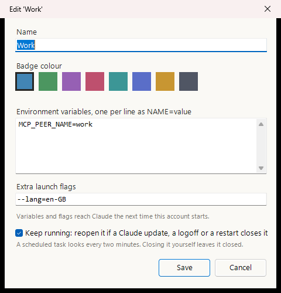
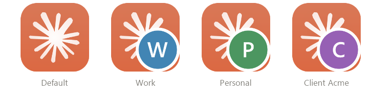
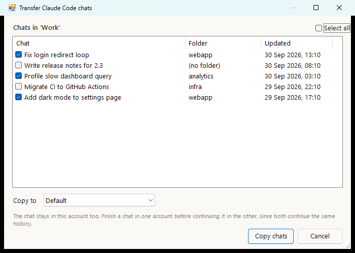
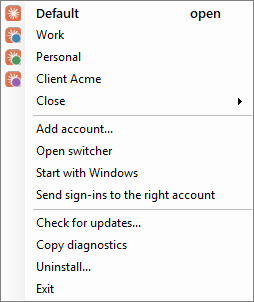
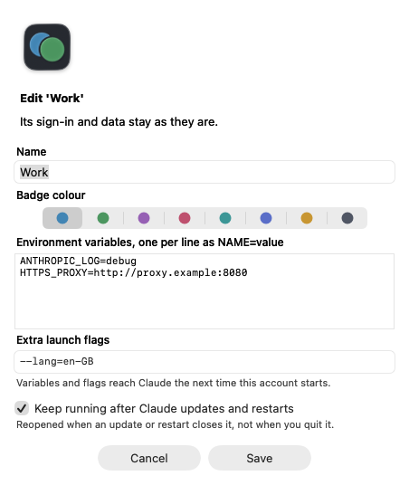
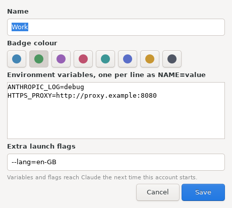
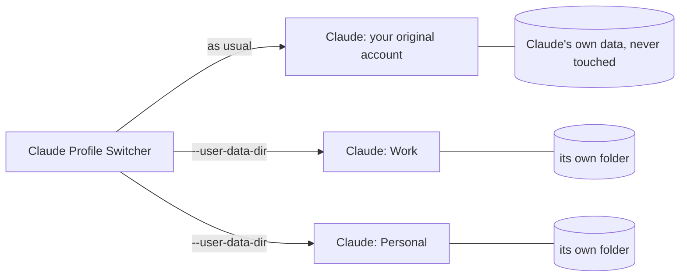

<div align="center">

# Claude Profile Switcher

**Use several Claude desktop accounts at the same time, on Windows, macOS and Linux.**<br>
Separate logins side by side, one click to add or switch, and nothing to sign out of.

[](https://github.com/PriyanshuGeTRekT/Claude-Code-Desktop-Switcher/stargazers)
[](https://github.com/PriyanshuGeTRekT/Claude-Code-Desktop-Switcher/releases)
[](https://github.com/PriyanshuGeTRekT/Claude-Code-Desktop-Switcher)
[](https://github.com/PriyanshuGeTRekT/Claude-Code-Desktop-Switcher/actions/workflows/lint.yml)
[](https://github.com/PriyanshuGeTRekT/Claude-Code-Desktop-Switcher/actions/workflows/macos.yml)
[](https://github.com/PriyanshuGeTRekT/Claude-Code-Desktop-Switcher/actions/workflows/linux.yml)
[](LICENSE)
<br>


<table>
<tr>
<td align="center"><b>Windows</b></td>
<td align="center"><b>macOS</b></td>
</tr>
<tr>
<td></td>
<td>
<picture>
  <source media="(prefers-color-scheme: dark)" srcset="docs/images/macos-switcher-dark.png">
  
</picture>
</td>
</tr>
<tr>
<td colspan="2" align="center"><b>Linux</b></td>
</tr>
<tr>
<td colspan="2" align="center">
<picture>
  <source media="(prefers-color-scheme: dark)" srcset="docs/images/linux-switcher-dark.png">
  
</picture>
</td>
</tr>
</table>

</div>

## Why

The Claude desktop app signs in one account at a time. If you have a work and a personal
account, or several clients, switching means signing out, signing back in and losing your
place. Claude Profile Switcher gives each account its own copy of the app with its own login,
so they all stay signed in and run at the same time, Claude Code included.

## Install

### Windows 10 or 11

Download **[Install-ClaudeProfileSwitcher.cmd](https://github.com/PriyanshuGeTRekT/Claude-Code-Desktop-Switcher/releases/latest/download/Install-ClaudeProfileSwitcher.cmd)**
and double-click it. It adds **Claude Profile Switcher** to the desktop and Start menu and
opens it. Or in PowerShell:

```powershell
irm https://github.com/PriyanshuGeTRekT/Claude-Code-Desktop-Switcher/releases/latest/download/ClaudeSwitcher.ps1 -OutFile "$env:TEMP\ClaudeSwitcher.ps1"; powershell -ExecutionPolicy Bypass -File "$env:TEMP\ClaudeSwitcher.ps1" -Install
```

### macOS 12 or later

Download **[ClaudeProfileSwitcher-macOS.zip](https://github.com/PriyanshuGeTRekT/Claude-Code-Desktop-Switcher/releases/latest/download/ClaudeProfileSwitcher-macOS.zip)**,
unzip it, and drag **Claude Profile Switcher** to Applications. The first time, **right-click
it and choose Open**: it is not notarized by Apple, so a plain double-click is refused once.
Or clear that flag in Terminal:

```bash
xattr -dr com.apple.quarantine "/Applications/Claude Profile Switcher.app"
```

It lives in the menu bar, and updates itself from **Check for Updates...** there.

### Linux (Ubuntu 22.04+, Debian 12+ and others)

It works with Anthropic's [Claude Desktop for Linux](https://claude.com/download) (beta, the
`claude-desktop` package) and with the community `claude-desktop-unofficial` build. On Ubuntu
or Debian, download **[claude-profile-switcher_all.deb](https://github.com/PriyanshuGeTRekT/Claude-Code-Desktop-Switcher/releases/latest/download/claude-profile-switcher_all.deb)**
and install it:

```bash
sudo apt install ./claude-profile-switcher_all.deb
```

On any other distribution, or without sudo, install it for your user only:

```bash
curl -fsSL https://github.com/PriyanshuGeTRekT/Claude-Code-Desktop-Switcher/releases/latest/download/ClaudeProfileSwitcher-linux.tar.gz | tar -xz && sh ClaudeProfileSwitcher-linux/install.sh
```

Then open **Claude Profile Switcher** from the app menu, or run `claude-switcher`.

## Add your second account in three steps

1. Click **Add Account** in the switcher (also in the macOS menu bar).
2. A new Claude window opens at the sign-in screen. Sign in with your other account.
3. Done. Both accounts stay signed in from now on. Give the new one a name like `Work`
   with **Edit...**: <kbd>F2</kbd> on Windows, under **More** on macOS, under **⋮** on Linux.

From then on, **Launch** opens an account, or brings it to the front if it is already open.

## Features

| | Windows | macOS | Linux |
| --- | :---: | :---: | :---: |
| Several accounts open at once, each with its own login | ✓ | ✓ | ✓ |
| One-click **Add Account**, straight to the sign-in screen | ✓ | ✓ | ✓ |
| Switch to, quit or restart any account | ✓ | ✓ | ✓ |
| **Edit**: name, colour badge, environment variables, launch flags | ✓ | ✓ | ✓ |
| Browser sign-ins go to the account that asked | ✓ | ✓ | ✓ |
| Move Claude Code chats between accounts | ✓ | ✓ | ✓ |
| Each account has its own taskbar or Dock entry | ✓ | ✓ | ✓ |
| Launchers per account | Desktop, Start menu | | App menu, dock actions |
| Reopen accounts after Claude's own auto-update closes them | ✓ | ✓ | not needed¹ |
| Tray or menu bar, start at login | ✓ | ✓ | |
| Self-update, checksum verified | ✓ | ✓ | ✓² |
| Diagnostics, clean uninstall, command line | ✓ | ✓ | ✓ |
| Your original account is never touched | ✓ | ✓ | ✓ |

¹ Claude for Linux does not update itself while running; updates come with `apt upgrade`.
² For a per-user install. The .deb is updated by installing the new .deb.

## Windows guide



| Action | In the window | Keyboard |
| --- | --- | --- |
| Open an account, or switch to it | **Launch** / **Switch to**, double-click | <kbd>Enter</kbd>, <kbd>Ctrl</kbd>+<kbd>1</kbd>..<kbd>9</kbd> |
| Add an account | **Add account** | <kbd>Ctrl</kbd>+<kbd>N</kbd> |
| Name, colour, variables, flags, keep running | **Edit...** | <kbd>F2</kbd> |
| Close or restart its Claude | **Close**, right-click **Restart** | |
| Shortcuts on the desktop and Start menu | **Shortcuts** | |
| Copy Claude Code chats to another account | **Transfer chats** | |
| Delete an account | **Delete** | <kbd>Del</kbd> |

Right-click any account for the same actions. Closing the window keeps the switcher in the
notification area: right-click its icon to switch accounts, add one, close one, check for
updates, or turn on **Start with Windows**.

<br clear="right">

<details>
<summary><b>Browser sign-ins and <code>claude://</code> links</b></summary>

Signing in through the browser ends with a `claude://` link, and Windows sends every one of
those to your original account. The first time you add an account, the switcher offers to
handle those links and pass each sign-in to the account that asked for it. Turn it on or off
from the tray (**Send sign-ins to the right account**), or with `-RouteSignIns` and `-Revert`.

A sign-in goes to the first of these that applies: the account you launched while it was
signed out, the only open account that is signed out, the open account you used last, and
otherwise your original one. Other `claude://` links, such as a link to a Claude Code session,
open in your original account unless you choose otherwise: `-OpenLinksIn Work` sends them all
to `Work`, and `-OpenLink <url> -Account Work` opens a single link there.

> [!NOTE]
> On the Store build of Claude, Windows keeps `claude://` links for Claude until you choose
> otherwise. Turning routing on opens Settings at the right page: set **CLAUDE** to
> **Claude Profile Router**. `-Status` shows whether that step is still to do.
</details>

<details>
<summary><b>Keeping accounts open through Claude's updates</b></summary>

When Claude installs an update while idle, Windows closes every copy of it and the app
brings back only your original account. Logoff and restart do the same. For an account that
has to stay up (Remote Control, scheduled tasks, long Claude Code sessions), tick **Keep
running** in **Edit...**, or run `-KeepRunning Work`.

A per-user scheduled task then looks every two minutes and at logon, and reopens a kept
account only when its own log ends in a forced close; one you closed yourself stays closed.
It waits out an update in progress, reopens minimized, never takes the foreground, and never
reopens the same account twice within ten minutes. Each action is written to
`%LOCALAPPDATA%\ClaudeProfiles\.switcher\watchdog.log`.
</details>

<details>
<summary><b>Shortcuts and taskbar buttons</b></summary>



**Shortcuts** puts a `Claude - <name>` shortcut on the desktop and in the Start menu, so you can
search for an account or pin it. Each extra account's window also gets its own taskbar button
with its badge instead of piling onto Claude's, and a pinned shortcut shares that button. Your
original account keeps Claude's own button.
</details>

<details>
<summary><b>Moving Claude Code chats between accounts</b></summary>



Select an account, click **Transfer chats**, tick the chats and pick where they go. The chat
stays in the original account too, and both continue the same history, so finish in one before
picking it up in the other. The target account needs to have opened the Code tab once.
</details>

<details>
<summary><b>Environment variables and launch flags per account</b></summary>

Set them in **Edit...**: variables one per line as `NAME=value`, flags as you would type them.
If the account is open, the switcher offers to restart it so they take effect. They are stored
in `%LOCALAPPDATA%\ClaudeProfiles\settings.json`, keyed by the account's folder name:

```json
"ProfileEnv":  { "Work": { "MCP_PEER_NAME": "work" } },
"ProfileArgs": { "Work": "--lang=en-GB", "Personal": ["--lang", "fr-FR"] }
```

A copy that is already open keeps what it started with. Your original account on the Store
build starts through Windows and takes neither.
</details>

<details>
<summary><b>The tray menu</b></summary>


</details>

## macOS guide

The switcher sits in the menu bar. Its menu lists every account with its badge (open ones are
ticked) and <kbd>⌘</kbd>+<kbd>1</kbd>..<kbd>9</kbd> to open them, plus **Add Account**
(<kbd>⌘</kbd>+<kbd>N</kbd>), **Quit Account**, **Show Accounts...**, **Open at Login**,
**Send Sign-ins to the Right Account** and **Check for Updates...**. The window has
**Open** / **Switch to** and **Quit** for each account, and **More** for Edit, Restart,
Transfer Code Chats, Show in Finder and Delete. Each open account gets its own Dock icon.

<picture>
  <source media="(prefers-color-scheme: dark)" srcset="docs/images/macos-edit-dark.png">
  
</picture>

- **Sign-ins.** With **Send Sign-ins to the Right Account** on, the switcher handles
  `claude://` links and hands each sign-in to the account waiting for it, as on Windows.
  macOS asks once whether the switcher may control Claude: allow it, since that is how the
  link reaches the right copy.
- **Keep running** (in **Edit...**) reopens an account when a Claude update, a logoff or a
  restart closed it, through a per-user launch agent that checks every two minutes.
- Your original account uses Claude's own data in `~/Library/Application Support/Claude`, which
  the switcher never touches. Extra accounts live in
  `~/Library/Application Support/ClaudeProfiles/<name>`, with `settings.json` beside them using
  the same keys as on Windows.

The app is one Swift file with no dependencies; `macos/build.sh` builds it. It is built and
tested on every change against a stand-in Claude (the screenshots come from that run), but
not yet against the real Claude on a real Mac. Please
[open an issue](https://github.com/PriyanshuGeTRekT/Claude-Code-Desktop-Switcher/issues) with
what you see.

## Linux guide

Run **Claude Profile Switcher** from the app menu. The window lists every account with
**Open** / **Switch to** and **Quit**, and **⋮** for Edit, Restart, Transfer Code Chats, Open
Folder and Delete. The **☰** menu turns on sign-in routing and **Show Accounts in the App
Menu**, which gives each account its own launcher and coloured icon and lists them all as
quick actions when you right-click the switcher in the dock.



- **Its own taskbar entry.** Each account runs with a window class of its own, so it is not
  grouped with your other Claude windows, and pinning it keeps that account.
- **Sign-ins.** With routing on, the switcher is the `claude://` handler (in your
  `~/.config/mimeapps.list`, with the previous handler restored on **--revert**), and hands
  each sign-in to the account waiting for it.
- Your original account is Claude's own `~/.config/Claude`. Extra accounts live in
  `~/.config/ClaudeProfiles/<name>`, with the same `settings.json` keys as everywhere else.
- The window needs GTK 3 for Python (`python3-gi`), which Ubuntu and Debian desktops include.
  Everything also works from the command line.

Claude for Linux is a beta from Anthropic. The switcher is tested on every change on Ubuntu
against a stand-in Claude that behaves like Electron, but not yet against the real beta.
Reports are very welcome.

## Command line

<details>
<summary><b>Windows</b> (<code>ClaudeSwitcher.ps1</code>)</summary>

| Command | Does |
| --- | --- |
| `-AddAccount` | Add an account and open Claude at its sign-in screen |
| `-Launch Work` | Open an account, or bring it forward if it is open |
| `-Close Work` / `-Restart Work` | Close its Claude / close it and open it again |
| `-List` | Accounts and which are running |
| `-Shortcut Work [-To <dir>]` | Shortcuts for one account |
| `-KeepRunning Work` / `-StopKeeping Work` | Reopen it after Claude's updates, or stop |
| `-RouteSignIns` / `-Revert` / `-Status` | Sign-in routing on, off, and its state |
| `-OpenLink <url> -Account Work` | Open one `claude://` link in an account |
| `-OpenLinksIn Work` | Send links that are not sign-ins there from now on |
| `-Update` / `-Version` | Install the latest release / print the version |
| `-Install` / `-Uninstall [-RemoveProfiles]` | Install or refresh; remove everything it created |
| `-ShortcutStyle headless\|hidden\|plain` | Remake launchers in a plainer shape for strict antivirus |
| `-Doctor` | What a bug report needs, user name redacted |
| `-Tray` / `-ClaudePath <exe>` | Start in the tray / use this Claude.exe |

Names can be an account's label or its folder name.
</details>

<details>
<summary><b>macOS</b> (<code>"/Applications/Claude Profile Switcher.app/Contents/MacOS/ClaudeSwitcher"</code>)</summary>

| Command | Does |
| --- | --- |
| `--add-account` | Add an account and open Claude at its sign-in screen |
| `--launch Work` | Open an account, or bring it forward if it is open |
| `--quit Work` / `--restart Work` | Quit its Claude / quit it and open it again |
| `--list` | Accounts and which are open |
| `--rename Work Client` | Rename (the folder and sign-in stay) |
| `--delete Work` | Delete an account and its folder |
| `--chats Work` / `--transfer Work Personal --all` | List Claude Code chats / copy them to another account |
| `--keep-running Work` / `--stop-keeping Work` | Reopen it after Claude's updates, or stop |
| `--route-sign-ins` / `--revert` / `--status` | Sign-in routing on, off, and its state |
| `--open-link <url> --account Work` / `--open-links-in Work` | Open one `claude://` link there / send other links there |
| `--open-at-login on\|off` | Start the switcher at login |
| `--check-update` / `--update` | Look for / install the latest release |
| `--doctor` / `--uninstall [--remove-profiles]` | Bug report details / remove what it made |
| `--claude-path <app>` / `--version` | Use this Claude.app / print the version |
</details>

<details>
<summary><b>Linux</b> (<code>claude-switcher</code>)</summary>

| Command | Does |
| --- | --- |
| `--add-account` | Add an account and open Claude at its sign-in screen |
| `--launch Work` | Open an account, or bring it forward if it is open |
| `--quit Work` / `--restart Work` | Quit its Claude / quit it and open it again |
| `--list` | Accounts and which are open |
| `--rename Work Client` / `--delete Work` | Rename (folder and sign-in stay) / delete |
| `--edit Work --color 2 --flags=--lang=en-GB --env K=V` | Change colour, flags or variables |
| `--chats Work` / `--transfer Work Personal --all` | List Claude Code chats / copy them to another account |
| `--install-launchers` / `--remove-launchers` | Put each account in the app menu, or take them out |
| `--route-sign-ins` / `--revert` / `--status` | Sign-in routing on, off, and its state |
| `--open-link <url> --account Work` / `--open-links-in Work` | Open one `claude://` link there / send other links there |
| `--check-update` / `--update` | Look for / install the latest release |
| `--doctor` / `--uninstall [--remove-profiles]` | Bug report details / remove what it made |
| `--claude-path <path>` / `--version` | Use this Claude / print the version |
</details>

## How it works

The Claude desktop app is built on Electron, which honours `--user-data-dir`. An account is
just a folder with its own cookies, local storage and settings, so each folder is an
independent login, and Electron's single-instance lock is per folder, so copies pointed at
different folders run side by side.



Nothing in Claude is modified, patched or proxied, and the switcher never handles passwords
or tokens: you sign in to each account in Claude itself.

<details>
<summary><b>Windows details</b></summary>

- **Two builds of Claude**, both detected: the Store (MSIX) build, whose original data lives in
  `%LOCALAPPDATA%\Packages\Claude_<id>\LocalCache\Roaming\Claude` and which the switcher starts
  through the shell so it keeps auto-update and `claude://` links; and the installer build,
  with its data in `%APPDATA%\Claude`.
- **Extra accounts live in `%LOCALAPPDATA%\ClaudeProfile-<name>`**, directly under
  `%LOCALAPPDATA%`, because Cowork's local VM service only finds its disk image there. Older
  versions used `%LOCALAPPDATA%\ClaudeProfiles\<name>`; those move once, and a link left at
  the old place keeps Code chats that remember the old path working.
- **Renaming changes a label only.** A folder is an account's permanent id, because Electron
  stores absolute paths inside its data.
- **Running detection** counts only the desktop app's own process, not the Claude Code CLI,
  which is also called `claude.exe`.
- **Sign-in routing is off until you turn it on.** It then takes over the `claude://` handler
  in `HKCU`, after saving Claude's own to `.switcher\claude-handler-backup.json`, which
  `-Revert` restores. Links are validated before use and never logged, because a sign-in link
  carries a one-time code.
- **Updates** fetch a 300-byte checksum file from this repository's releases once a day, and the
  script only when it changed. A new script is installed only when it matches the published
  checksum, and only after you agree. `"UpdateCheck": false` in `settings.json` turns the
  daily check off. See [SECURITY.md](SECURITY.md) for everything the switcher writes or reads.
</details>

<details>
<summary><b>macOS and Linux details</b></summary>

- **Running detection** reads each process's arguments: an account is the Claude process
  started with its folder, and Electron's helper processes (`--type=...`) are not counted.
- **Sign-in routing** works the same way everywhere: the account started while signed out,
  else the only open account that is signed out (read from its `config.json`, key presence and
  length only), else the one whose window was used last, else your original account. On macOS
  the link is handed over as an Apple Event to that account's process; on Linux, by starting
  that account's Claude with the link, which Electron's single-instance lock passes to the copy
  already open. Claude making itself the handler again as it starts is undone at once.
- **Updates** look at where GitHub's "latest release" points, once a day, and install the new
  app or program only when it matches the release's `SHA256SUMS.txt` (and on macOS, passes
  `codesign --verify` and carries the same bundle id).
</details>

## FAQ

<details>
<summary><b>Can I use two Claude accounts at the same time?</b></summary>

Yes. Each account runs in its own copy of the Claude desktop app with its own login, so you
can have a work and a personal account (or several) open and signed in at once.
</details>

<details>
<summary><b>Does it work with Claude Code in the desktop app?</b></summary>

Yes. Each account has its own Code tab and sessions. You can also copy Code chats from one
account to another, and on Windows and macOS keep accounts that run long Code sessions open
through Claude's updates.
</details>

<details>
<summary><b>Will it sign me out of my current account?</b></summary>

No. Your original account keeps using Claude's own data, which the switcher never touches.
New accounts get folders of their own.
</details>

<details>
<summary><b>Does it modify Claude or see my password?</b></summary>

No. It only starts the official app with a different data folder. You sign in inside Claude
itself, and the switcher never reads tokens or passwords.
</details>

<details>
<summary><b>How much memory does each account use?</b></summary>

Each open account is a full copy of the app, so roughly one Claude's worth of memory per
account. A folder grows to a few hundred MB, mostly caches. On Windows, an account that runs
Cowork tasks locally also starts its own Linux VM (about 4 GB of memory, 10 GB of disk).
</details>

<details>
<summary><b>What about the <code>claude</code> command line tool?</b></summary>

This is for the desktop app. The `claude` CLI already supports several accounts through its
`CLAUDE_CONFIG_DIR` environment variable.
</details>

## Troubleshooting

<details>
<summary><b>Claude cannot be found</b></summary>

Point at it once and it is remembered: `-ClaudePath C:\path\to\Claude.exe` on Windows,
`--claude-path /path/to/Claude.app` on macOS, `--claude-path /path/to/claude-desktop` on Linux.
On Linux the switcher looks for the `claude-desktop` and `claude-desktop-unofficial` commands.
</details>

<details>
<summary><b>The window does not open (Linux)</b></summary>

It needs GTK 3 for Python: `sudo apt install python3-gi python3-gi-cairo gir1.2-gtk-3.0`.
Everything else works without it from the command line.
</details>

<details>
<summary><b>My antivirus deletes the shortcuts (Windows)</b></summary>

The shortcuts run `conhost --headless powershell -ExecutionPolicy Bypass -File ...`, which some
products (Huorong has been reported) take for a trojan pattern. Remake them in a plainer shape:

```powershell
.\ClaudeSwitcher.ps1 -ShortcutStyle hidden    # no conhost; a console may flicker
.\ClaudeSwitcher.ps1 -ShortcutStyle plain     # also without -ExecutionPolicy Bypass
```

`plain` needs `Set-ExecutionPolicy -Scope CurrentUser RemoteSigned` once.
`-ShortcutStyle headless` goes back to the default.
</details>

<details>
<summary><b>"Claude Profile Switcher cannot be opened" (macOS)</b></summary>

The app is not notarized by Apple. Right-click it in Applications and choose **Open** once, or
run `xattr -dr com.apple.quarantine "/Applications/Claude Profile Switcher.app"`.
</details>

<details>
<summary><b>The script will not run, or a shortcut does nothing (Windows)</b></summary>

Use `-ExecutionPolicy Bypass` as in the install line, and `Get-ChildItem -Recurse | Unblock-File`
if you downloaded the ZIP. Anything fatal is shown in a message box and written to
`%LOCALAPPDATA%\ClaudeProfiles\switcher-error.log`. For a bug report, paste the output of
`.\ClaudeSwitcher.ps1 -Doctor` (or the tray's **Copy diagnostics**): versions, accounts and
recent log lines, with your user name replaced.
</details>

<details>
<summary><b>Removing it</b></summary>

Windows: the tray's **Uninstall...**, or `-Uninstall`. That removes shortcuts, the watchdog task,
sign-in routing and the installed copy, and keeps your accounts and settings unless you add
`-RemoveProfiles`. macOS: run `--uninstall` (launch agents and sign-in routing), quit it from
the menu bar and move the app to the Bin. Linux: `claude-switcher --uninstall`, then
`sudo apt remove claude-profile-switcher` for the .deb. On both, accounts stay unless you add
`--remove-profiles`.
</details>

## What has been verified

- **Windows:** tested on Windows 11 with the Store build of Claude: install, adding accounts,
  switching, running detection beside Claude Code sessions, shortcuts and taskbar buttons,
  sign-in routing with real sign-ins, the tray, updates, and the watchdog's task. Ten test
  suites run on every change in Windows PowerShell 5.1 and PowerShell 7. The installer build
  of Claude, and chat transfer between two real accounts, have not been tried yet.
- **macOS:** built for Apple Silicon and Intel and tested end to end on every change against a
  stand-in Claude: adding, opening, switching, flags and variables, rename, quit, delete, chat
  transfer, keep running through its launch agent, sign-in routing, self-update with a tampered
  checksum, all in a folder path with spaces. Not yet run against the real Claude on a real Mac.
- **Linux:** tested end to end on every change on Ubuntu against a stand-in Claude that starts
  Electron-style helper processes and hands a second start to the first copy: accounts, edit,
  chat transfer, app menu launchers (validated), sign-in routing including a link opened
  through the desktop, self-update, and installing the .deb and the tarball. Not yet run
  against Anthropic's real Linux beta.

Reports from any of those untested setups are the most useful contribution anyone can make
right now.

## Star history

<a href="https://star-history.com/#PriyanshuGeTRekT/Claude-Code-Desktop-Switcher&Date">
  <picture>
    <source media="(prefers-color-scheme: dark)" srcset="https://api.star-history.com/svg?repos=priyanshugetrekt/claude-code-desktop-switcher&type=Date&theme=dark">
    
  </picture>
</a>

## Contributing

Issues and pull requests are welcome. See [CONTRIBUTING.md](CONTRIBUTING.md) for setup, the
tests to run on each platform, and the traps that have already caused bugs here. Please also
read the [Code of Conduct](CODE_OF_CONDUCT.md).

## Disclaimer

Unofficial, and not affiliated with, endorsed by, or supported by Anthropic. It uses only
documented Electron command line switches and does not modify the Claude application. Using
multiple accounts is subject to Anthropic's terms of service.

## License

MIT, see [LICENSE](LICENSE).
